## Lab news

Updates from ecoϕlab and collaborators.

::: {.news-story}
### A November trip to Juneau: tending the US-DGF tower and sap flow sensors

**November 9, 2026**

From November 3 to 8, ecoϕlab PI Gavin McNicol and PhD student Aaron MacDonald traveled to Juneau, Alaska, to maintain sap flow sensors and the **US-DGF (South Douglas Fen)** flux tower. US-DGF is a carbon- and water-monitoring station on a wetland on the southeast coast of Douglas Island, just across the channel from downtown Juneau.

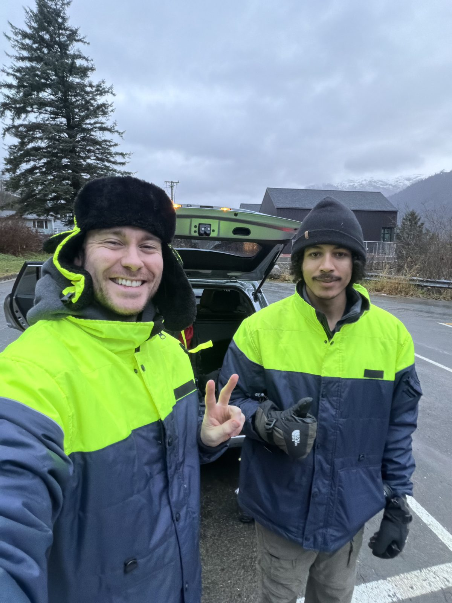{fig-alt="Selfie of two smiling researchers in bright yellow and navy high-visibility jackets, one in a fur trapper hat giving a peace sign and the other in a black beanie giving a thumbs-up, standing behind a car with its rear hatch open under grey skies with snowy mountains in the distance."}

#### A fen in the rainforest

Southeast Alaska sits in the perhumid (always wet) coastal temperate rainforest of the Northeast Pacific. The fen receives about 1,700 mm (roughly 67 inches) of precipitation in an average year, and between the forested slopes sit open, boggy wetlands that Alaskans call *muskeg*. South Douglas Fen is one of them: a gently sloping, spongy carpet of sphagnum moss and short plants, dotted with small ponds.

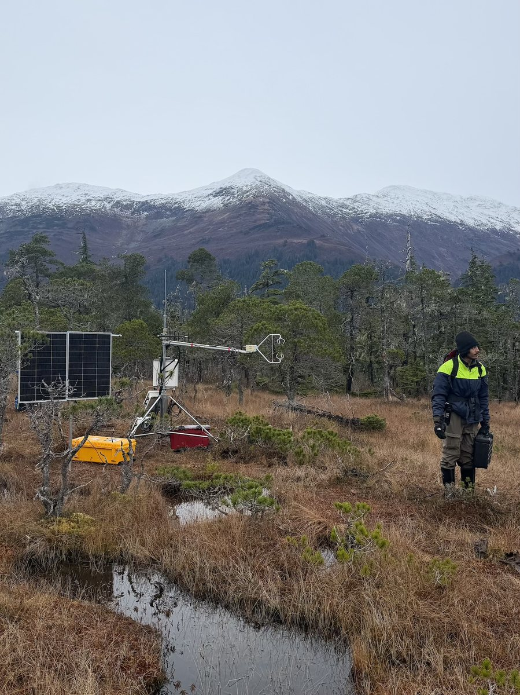{fig-alt="Aaron MacDonald in a navy and yellow high-vis jacket and black beanie standing in the muskeg at South Douglas Fen, holding a black case, with the US-DGF tower, solar panel, and snow-capped mountains beyond."}

Wetlands like this store huge amounts of carbon in their waterlogged soils, built up over thousands of years from mosses and plants that never fully decompose. US-DGF was established in 2026 to measure, around the clock, how much carbon dioxide (CO₂) and water vapor move between the fen and the air. The site is registered with [AmeriFlux](https://ameriflux.lbl.gov/sites/siteinfo/US-DGF), a network of hundreds of similar towers across the Americas that share their data so scientists can compare ecosystems from deserts to the Arctic.

#### How the tower "sees" the fen breathe

The station uses a method called **eddy covariance**. Air near the ground never moves smoothly; it tumbles in small swirls, or eddies. An ultrasonic wind sensor measures how fast the air is moving up and down, many times per second, while a gas analyzer measures how much CO₂ and water vapor that same air carries. Pairing those two measurements reveals whether the fen is, on balance, releasing CO₂ to the sky or pulling it in.

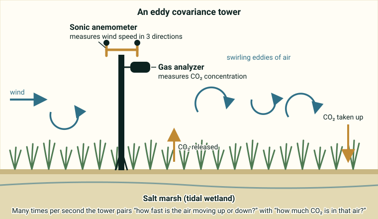{fig-alt="Cartoon of an instrument tower in a wetland with a sonic anemometer and a gas analyzer near the top, and curved arrows showing swirling eddies of air carrying CO2 up from and down to the ground."}

Scientists summarize the result as *net ecosystem exchange*, or NEE. By convention, a **negative NEE means uptake**: plants are photosynthesizing and the ecosystem is drawing CO₂ out of the atmosphere. A positive NEE means the ecosystem is releasing more CO₂ (through respiration by plants, microbes, and soil) than it absorbs. In a cool, wet place like Southeast Alaska, that balance swings with the seasons, and the long, dark winter is an important part of the story that is still poorly measured.

#### What we went to do

The trip was a maintenance visit rather than a new sampling campaign. In early November, Juneau has only about eight and a half hours of daylight, so the team hiked in at first light to reach the fen by mid-morning.

The main jobs were to look after the eddy-covariance instruments at US-DGF and the sap flow sensors that track how nearby trees move water. They also checked snow-depth sensors at a sub-canopy station—useful where winter snowpack can insulate shallow roots against frost—and worked on a cellular connection so the site can send data.

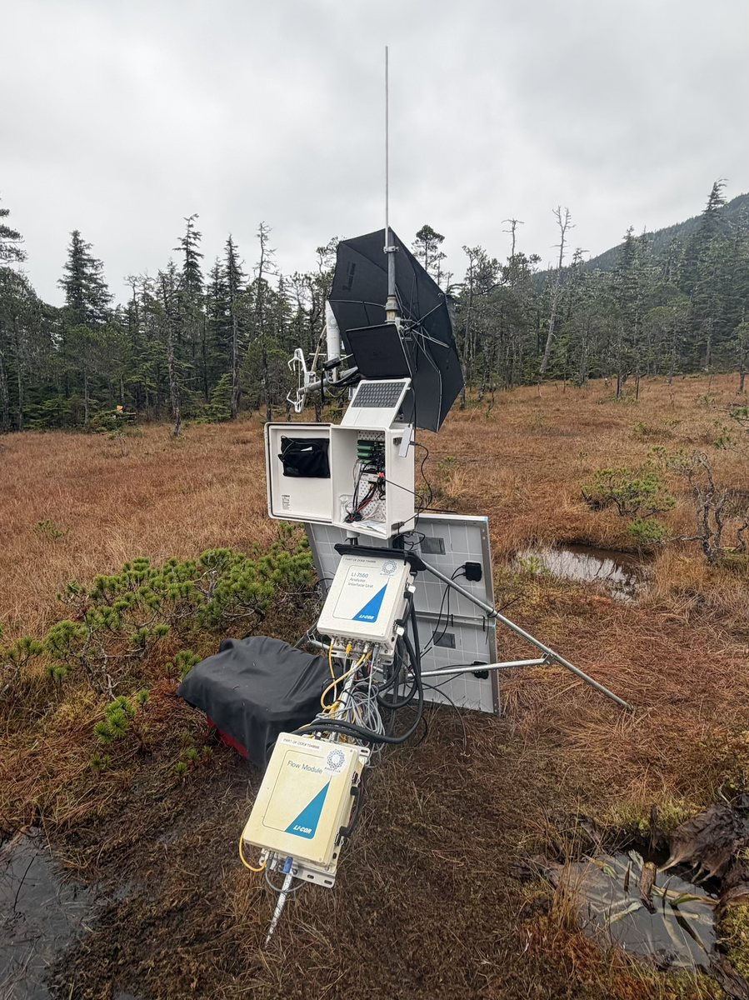{fig-alt="The US-DGF station on the muskeg, with an elevated solar panel, logger enclosure, LI-7500 Analyzer Interface Unit and Flow Module in the foreground, and wet fen vegetation around the instruments."}

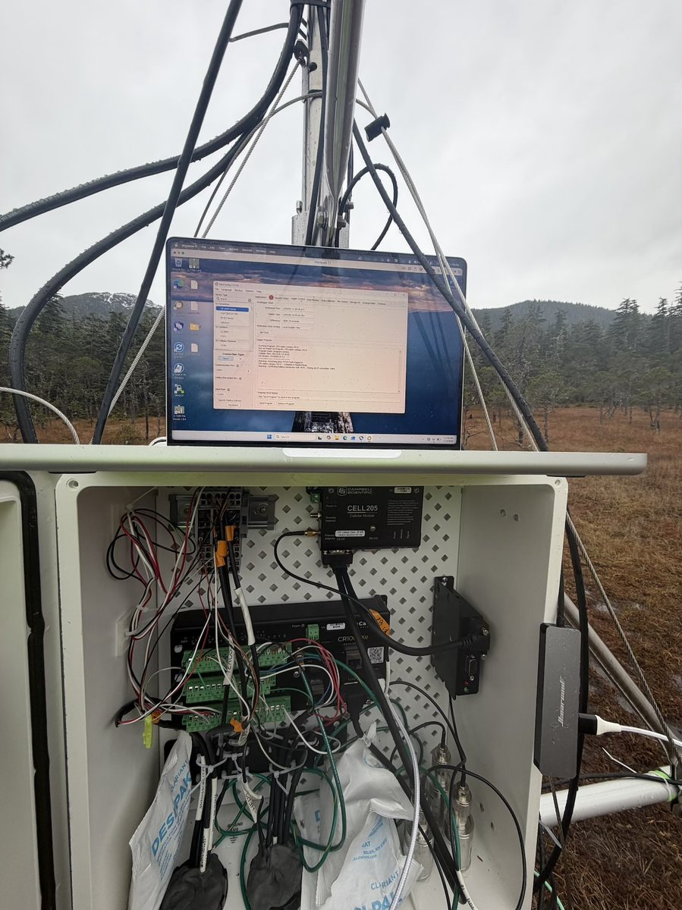{fig-alt="Open logger enclosure with a laptop resting on the open door, showing a desktop window, with wiring and a cellular modem visible inside and muskeg behind the station."}

On site they connected a laptop at the open logger enclosure to check the instruments and data.

There are no new scientific results to share from the visit itself. The aim was to keep the sensors running through the winter months.

#### Trees, water, and yellow-cedar decline

US-DGF is part of our broader research on Alaska's coastal rainforests, including a project funded by the U.S. Department of Energy on **yellow-cedar decline**. Yellow-cedar is a long-lived, culturally and ecologically important tree in Southeast Alaska, and over the past century many stands have died back. A leading explanation is that thinner winter snowpack leaves the trees' shallow roots exposed to damaging freezes. We want to understand how losing these trees changes the way rainforest landscapes exchange water and carbon with the atmosphere.

One way we follow trees' water use is by measuring **sap flow**. Trees pull water from the soil up through their trunks and release it as vapor from their leaves (transpiration). A small sensor inserted into the trunk gives a tiny pulse of heat and then compares temperatures just above and below it. The faster sap is moving up the tree, the more the heat is carried upward. In wet Southeast Alaska, this helps show how much water trees are moving—and how healthy and dying trees might differ.

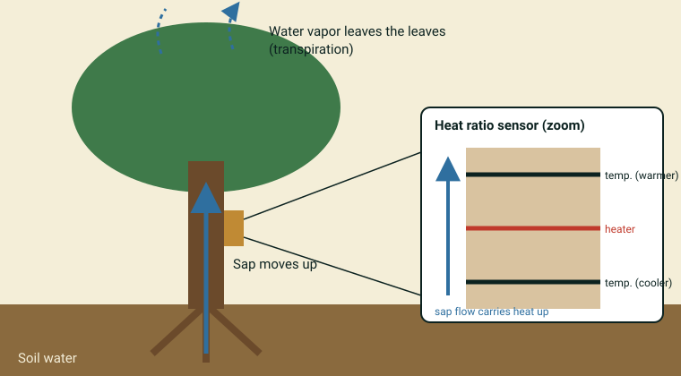{fig-alt="Cartoon tree with arrows showing water moving from the soil up the trunk to the leaves and escaping as water vapor, and a zoomed sensor with a heater needle between two temperature needles."}

Maintaining those sap flow sensors was one of the reasons for the November visit. The team also checked other field equipment, including a trail camera.

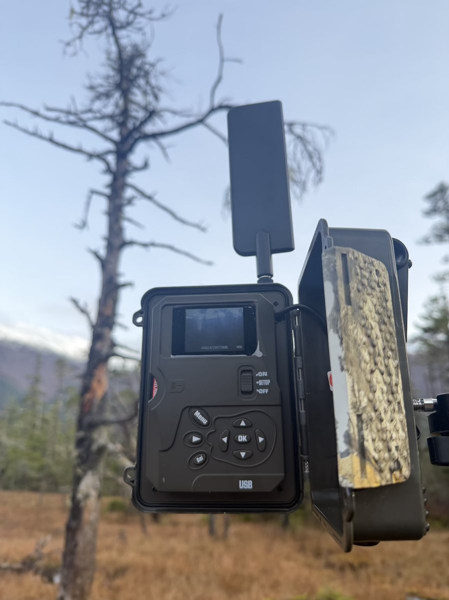{fig-alt="Trail camera with its front door open, with a dead conifer tree standing behind it."}

And, as always in Southeast Alaska, the shoreline offered its own rewards.

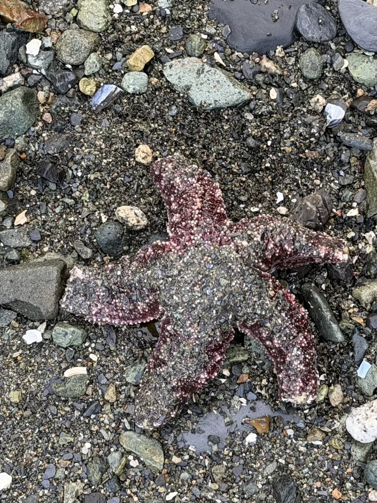{fig-alt="Purple-red starfish lying on a pebble beach."}

This work is part of our *Temperate Rainforest Geoecology* research theme. You can follow the site on its [AmeriFlux page for US-DGF](https://ameriflux.lbl.gov/sites/siteinfo/US-DGF).

*We acknowledge the Tlingit people as the traditional stewards of Deishú Áakʼw (Douglas Island) and the broader Lingít Aaní.*
:::

::: {.news-story}
### Chasing methane in the Calumet: a new soil experiment from Indian Ridge Marsh

**October 20, 2026**

Fall fieldwork season is in full swing, and this month ecoϕlab kicked off a new soil methane experiment using soils from Indian Ridge Marsh in Chicago's Calumet region on the city's Southeast Side. The project is led by undergraduate researcher Nick Fedchuk, working with PI Gavin McNicol, as part of his honors research in the lab.

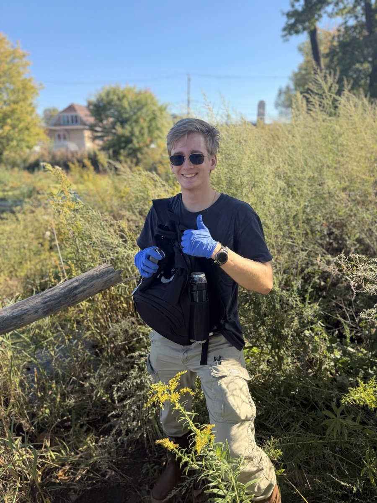{fig-alt="Smiling student in sunglasses and blue nitrile gloves giving a thumbs-up while standing in tall goldenrod and grasses at a marsh, carrying a field bag."}

Methane is a powerful greenhouse gas, and wetlands are one of its biggest natural sources. Much of it is made by soil microbes that thrive where there is little oxygen—while other microbes, living where oxygen is available, can eat methane before it ever reaches the air. The Calumet is a fascinating place to study this balance: restored marshes sit alongside landfills and industry, all within a dense urban landscape.

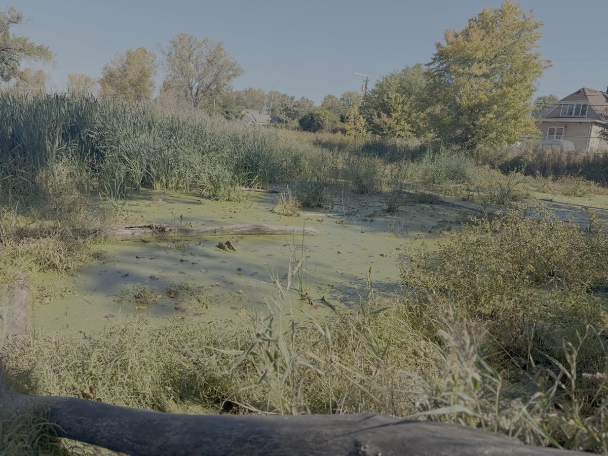{fig-alt="Wide view of a shallow marsh with open water and floating vegetation, fringed by golden grasses and trees under a blue sky."}

The broader project has two parts. First, a field survey of methane in the air and water around the Calumet to look for local microbial methane sources and possible hot spots. Second—the part now underway—a laboratory experiment with wetland soils collected near those sources.

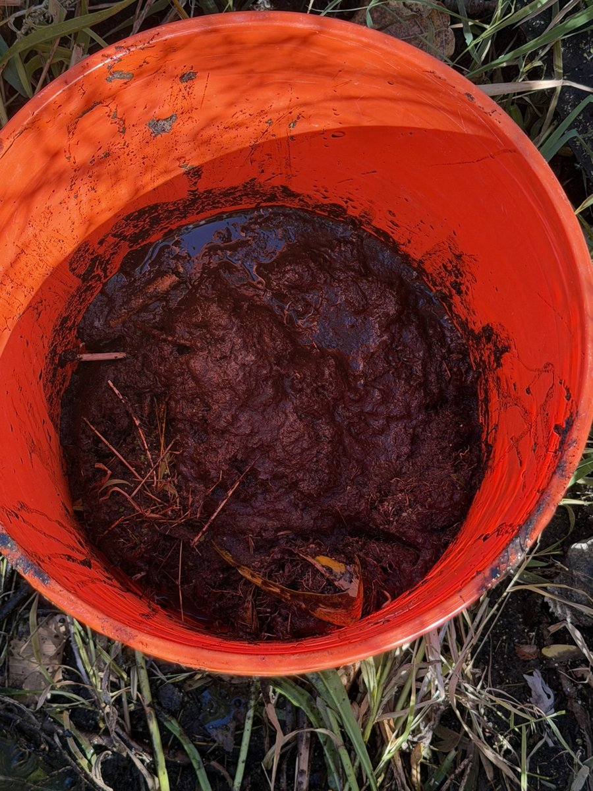{fig-alt="Orange five-gallon bucket filled with dark, wet marsh soil sitting among plants."}

Back at UIC, the team mixed the marsh soil and divided it into sealed glass jars. Some jars sit in ordinary air, while others go into a glovebox filled with nitrogen gas to mimic the oxygen-free conditions of waterlogged soil. Over about ten days, the team draws small samples of the air inside each jar and measures how much methane builds up or disappears. Comparing soil from near the surface with soil from deeper down helps show how wetness and oxygen shape whether a wetland breathes methane out or takes it in.

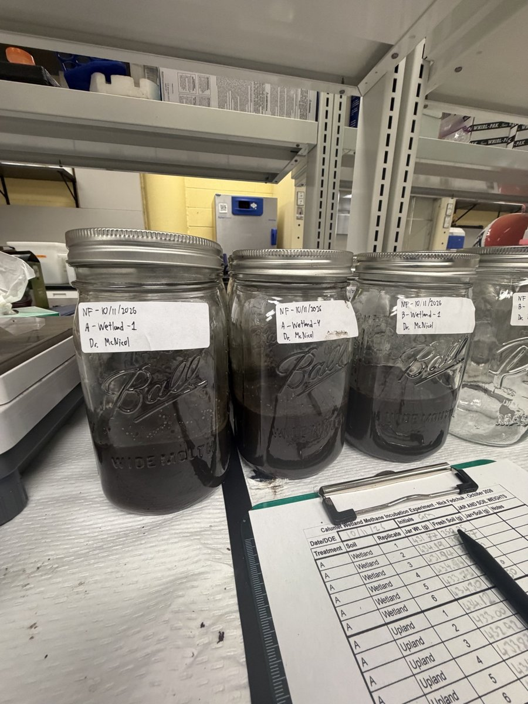{fig-alt="Several large glass jars filled with dark soil, sealed with lids, arranged on a laboratory bench."}

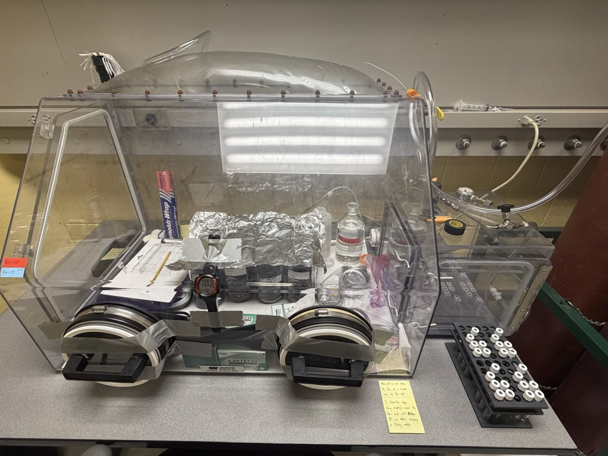{fig-alt="Clear acrylic laboratory glovebox with glove ports and sealed jars inside, on a lab bench."}

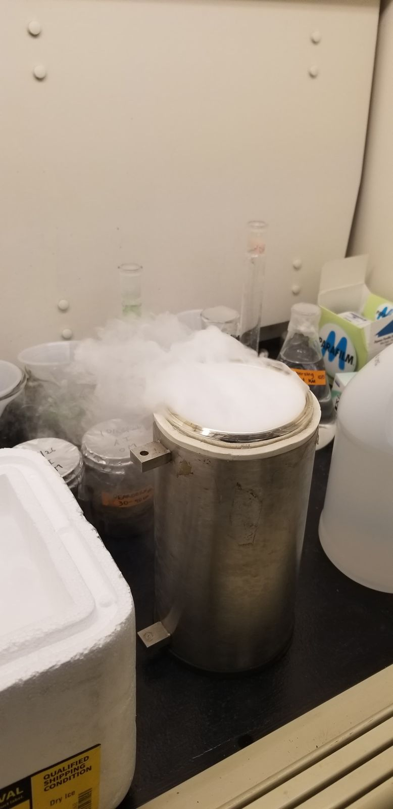{fig-alt="Stainless steel cylinder fogging over with a dry ice slurry, with soil sample jars beside it in a fume hood."}

When the gas measurements wrap up, the team will also look at soil chemistry and at the microbes themselves, tracking genes linked to making methane and consuming it. Together, these pieces will help connect what we see in the air with what is happening underground.

This work sits at the heart of two of our research themes, *Methane Fluxes Across Scales* and *Chicago Soil Biogeochemistry*. It's still early days—samples are being analyzed now—and we look forward to sharing what Nick finds, including at the UIC Honors College Capstone symposium later this fall.

:::

::: {.news-story}
### New paper from Nachusa Grasslands fieldwork

**October 6, 2026**

We're happy to share a new open-access paper from ecoϕlab and collaborators in *Frontiers in Environmental Science*. The work grows out of a 2022 field campaign at Nachusa Grasslands (Dixon, IL), where the team measured soil greenhouse gas fluxes—and their links to soil microbial communities—across restored oak woodland, open tallgrass prairie, and wet prairie.

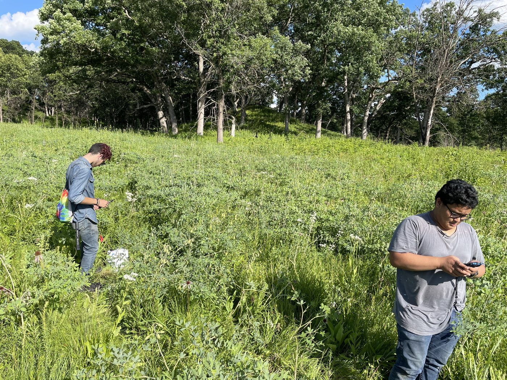{fig-alt="Two researchers standing in tall prairie vegetation at the woodland edge, checking handheld devices during fieldwork."}

Across the growing season, soils were consistent carbon dioxide sources, methane sinks, and roughly neutral for nitrous oxide. The headline finding is strong methane uptake—especially in woodland soils—while open prairie was often near neutral. Notably, even wet prairie showed no net methane emissions, which is unusual for saturated soils.

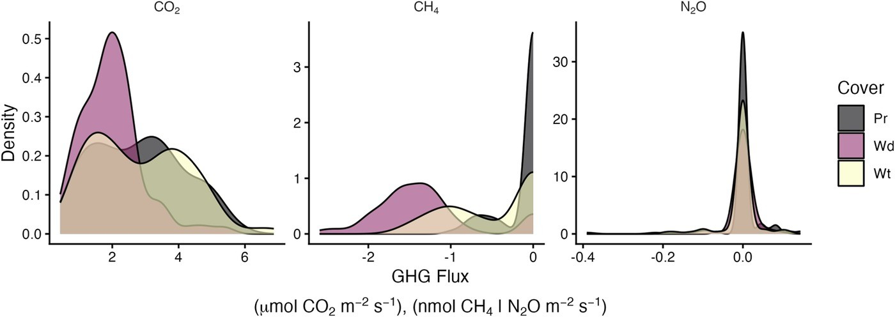{fig-alt="Three density plots comparing soil carbon dioxide, methane, and nitrous oxide fluxes across prairie, woodland, and wet prairie cover types."}

Decision-tree models pointed to soil temperature as the main control on carbon dioxide, and to cover type plus soil moisture for methane uptake. Woodland soils were the strongest methane sinks; in prairie, uptake tended to be stronger when soils were drier.

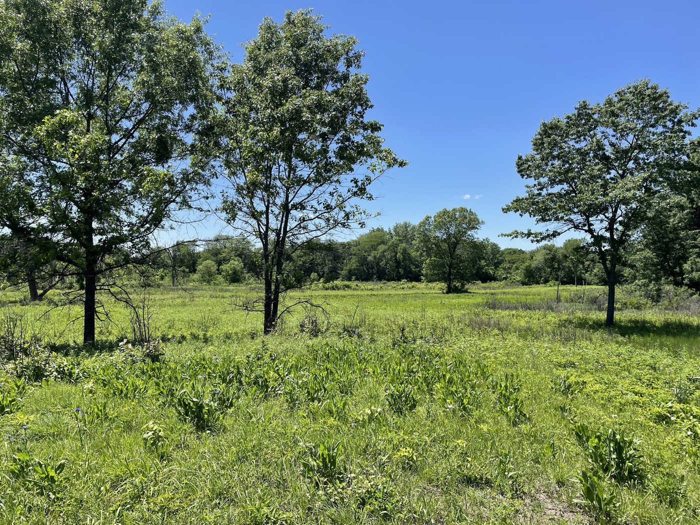{fig-alt="Sunny open prairie with scattered trees and a woodland edge under a clear blue sky at Nachusa Grasslands."}

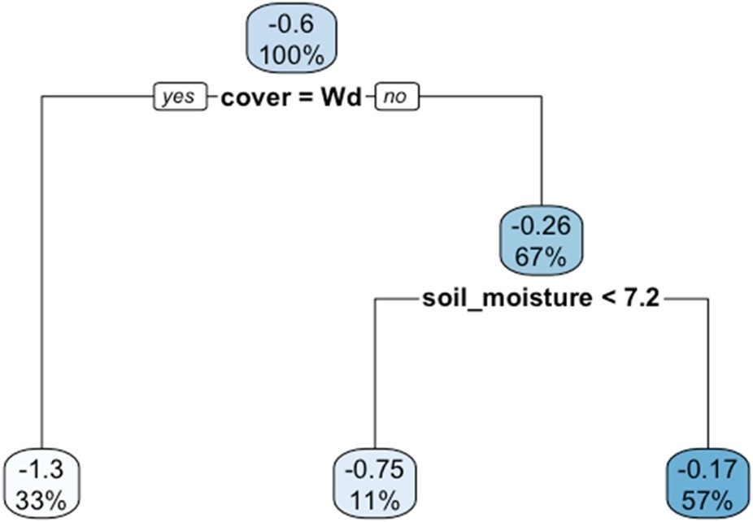{fig-alt="Decision tree showing woodland cover and soil moisture as the main splits explaining soil methane uptake."}

Inferred microbial communities were dominated by aerobic taxa—decomposers, nitrogen cyclers, and methane oxidizers—consistent with soils that consume methane rather than emit it. Together, the results suggest restored Midwest prairie–savanna ecosystems can act as net greenhouse gas sinks during the growing season, with woodland soils doing especially heavy lifting on methane.

The study was led by Gavin McNicol with coauthors Michael Yonker, Jack Breiter, Shamya Pugh, and D'Arcy R. Meyer-Dombard. Several of the student coauthors are now lab alumni—we're proud to see this chapter of the work in print.

You can read the article here: [doi:10.3389/fenvs.2026.1931059](https://doi.org/10.3389/fenvs.2026.1931059).

McNicol, G., Yonker, M., Breiter, J., Pugh, S., and Meyer-Dombard, D. R. (2026). Strong growing season soil methane uptake observed in a restored prairie-savanna. *Front. Environ. Sci.* 14, 1931059. doi: 10.3389/fenvs.2026.1931059
:::

::: {.news-story}
### AI Across Scales workshop at Yale

**October 2, 2026**

Last week, ecoϕlab PI Gavin McNicol co-hosted the **AI Across Scales** workshop at Yale with [Sparkle Malone](https://environment.yale.edu/) (Yale School of the Environment), bringing the AI for Natural Methane working group together for four days of talks, collaboration, and community.

The gathering ran September 29–October 2, 2026, with support from the Yale Center for Natural Carbon Capture and continuing support from Spark Climate Solutions. Sessions were held at the Yale Peabody Museum and the Yale Center for Geospatial Solutions, with hybrid links for remote participants. About 18 researchers joined in person and another 25 connected online, spanning Yale, UIC, Harvard, NASA, national labs, and partner universities.

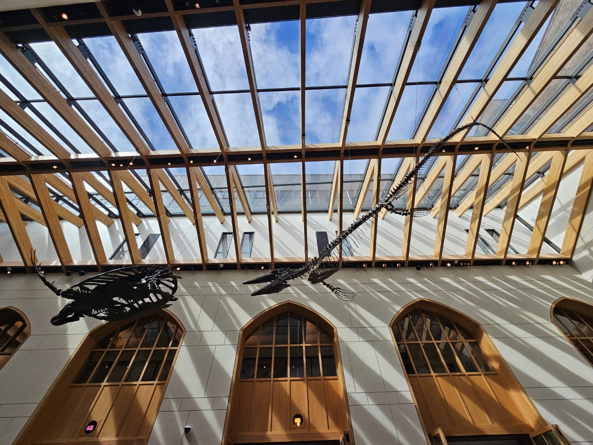{fig-alt="Bright atrium inside the Yale Peabody Museum with wooden skylight beams and suspended fossil skeletons."}

Day 1 opened with a public seminar and reception at the Peabody, followed by science talks and an open forum. Later in the week the group moved into working sessions—sharing tools, comparing approaches, and sketching next steps together.

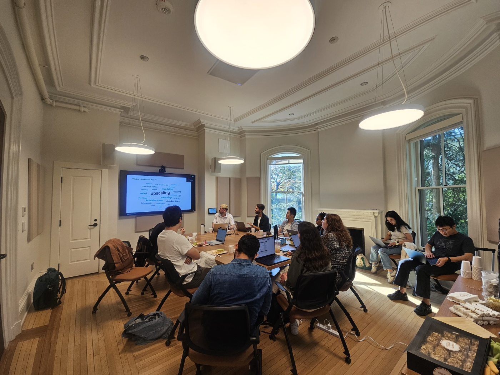{fig-alt="Researchers seated around a table with laptops during a workshop session at Yale."}

One highlight for visitors was a live demo of [WetLSP Explorer](https://github.com/McNicol-Lab/wetlsp-explorer-web-app/releases/latest), a desktop app from the lab that lets you explore wetland vegetation through the seasons on your own computer.

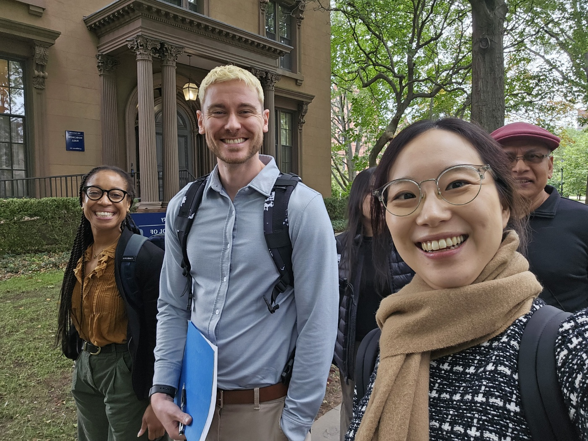{fig-alt="Small group of workshop participants smiling outdoors in front of a Yale building."}

On the final day, Gavin also received a Yale Impact Award for helping organize the week—a nice note of thanks from the hosts.

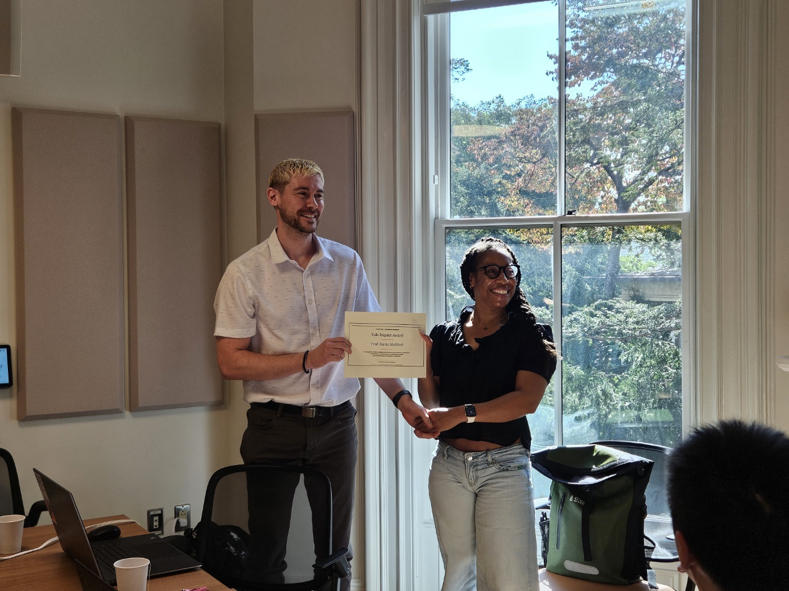{fig-alt="Gavin McNicol and a colleague holding a Yale Impact Award certificate."}

We're grateful to Yale, YCNCC, Spark Climate Solutions, the Peabody Museum, the Center for Geospatial Solutions, and everyone who traveled to New Haven or joined remotely.

Watch the workshop showcase on [YouTube](https://www.youtube.com/watch?v=SnREfRfc_Ko), or find it with our other talks on the [Media page](media.html).
:::
